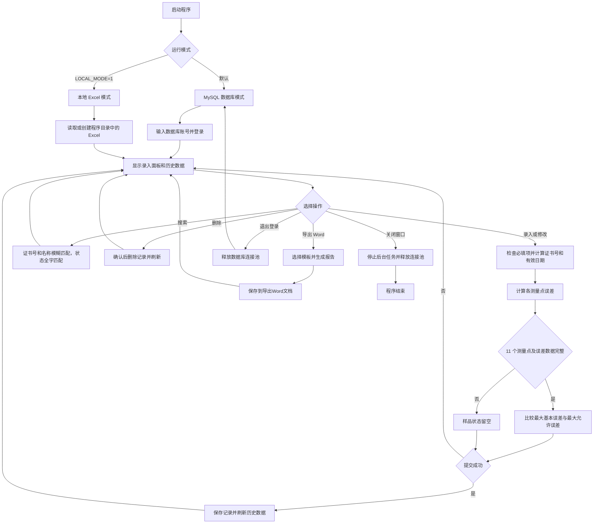

## 需求

### 一、形式

1. 网页/应用

### 二、功能

1. [X] 校验数据录入
2. [X] 历史数据读取-在此基础上修改
3. [X] 报告导出（beta）
4. [X] 全生命周期到期提醒
5. [X] 检定周期提醒管理

#### todo Urgent

* [ ] 汇报前新增*全生命周期邮件提醒功能

### todo

* [ ] 上云

* [ ] 流程审批
* [ ] 网页端重构

### 运行模式

- 默认使用 MySQL 数据库；设置环境变量 `LOCAL_MODE=1` 可切换为本地 Excel 模式。
- 数据库连接参数通过 `MYSQL_HOST`、`MYSQL_PORT`、`MYSQL_USER`、`MYSQL_PASSWORD` 和 `MYSQL_DATABASE` 配置。

## 使用说明

### 环境准备

Windows 源码运行需要安装 Python。建议在项目目录创建虚拟环境并安装依赖：

```powershell
py -m venv .venv
.\.venv\Scripts\Activate.ps1
python -m pip install --upgrade pip
python -m pip install -r requirements.txt openpyxl python-docx
```

Windows Python 安装包需要包含 Tcl/Tk，程序使用它显示桌面界面。启动源码版：

```powershell
python CMDSystemClient.py
```

默认进入 MySQL 模式。在程序的“数据库登录”区域输入数据库用户名和密码；数据库地址、端口和库名可通过前述环境变量配置。请勿把数据库密码写入源码或提交到版本库。

切换到本地 Excel 模式时，在启动程序的 PowerShell 窗口设置：

```powershell
$env:LOCAL_MODE = "1"
python CMDSystemClient.py
```

本地模式首次启动会在程序目录创建 `设备校验数据.xlsx`。当前版本不会自动迁移旧版 Excel 表头；已有旧文件请先备份并完成字段结构调整后再使用本地模式。

### 目录与文件

- 源码运行时，数据和模板路径以 `CMDSystemClient.py` 所在目录为基准；打包运行时以 `.exe` 所在目录为基准。
- 默认 Word 模板文件名为 `template.docx`。打包配置没有将模板嵌入程序，因此请将模板放在 `.exe` 旁，或在导出时通过文件选择器指定其他模板。
- 导出的报告保存在程序目录下的 `导出Word文档` 文件夹中；该文件夹会在首次导出时创建。
- 请将程序放在当前 Windows 用户有写入权限的目录中。若放在受保护目录，Excel 文件或导出报告可能无法创建。

### 日常操作

1. 在“数据录入”填写带 `*` 的必填字段。证书编号、有效日期、误差和最大基本误差由程序计算或只读显示。
2. 填写设备精度、量程范围、输出范围及 11 个输出测量值后，程序计算各点误差和最大基本误差。只有误差与允许误差均有效且 11 个测量点完整时，才显示样品状态；最大基本误差大于最大允许误差时为“不合格”，否则为“合格”。
3. 点击“提交数据”新增记录；在“历史数据”选中一条记录后点击“修改选中”可编辑，点击“删除选中”并确认可删除。
4. 不合格记录在历史表中整行标红。投运日期和校验日期的到期颜色在不合格行上让位；左侧绿色标记用于指示最近操作的记录。
5. 搜索框支持按证书编号或样品名称模糊搜索，按样品状态全字搜索。状态搜索“合格”不会匹配“不合格”。
6. 选择记录并点击“导出选中到Word”，选择 Word 模板后，程序生成报告并保存到 `导出Word文档`。
7. 数据库模式可点击“退出登录”关闭数据库会话；关闭窗口也会释放连接池。退出程序前请等待正在进行的数据操作完成。

## 程序流程图


